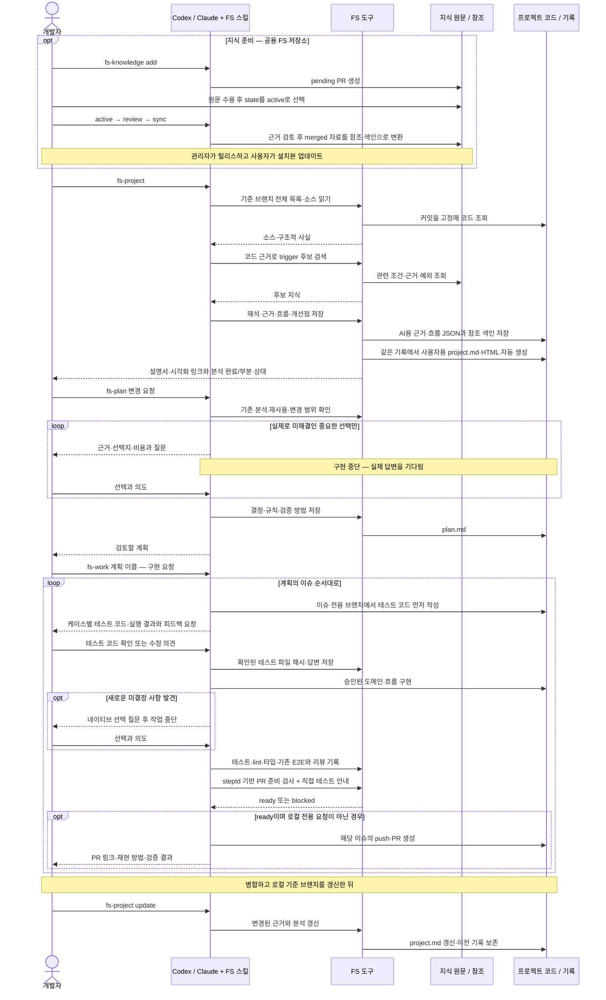

# Frontend System

FS는 저장한 지식을 프로젝트 코드와 연결해 **분석 → 질문과 결정 → 계획 → 구현과 검증**을 돕는 Codex·Claude Code 플러그인입니다. 코드를 해석하는 주체는 현재 대화의 AI이며, FS는 지식 검색과 근거·결정·검증 기록을 제공합니다.

## 설치와 업데이트

Node.js와 Git, 사용할 클라이언트의 CLI가 필요합니다. **이 절의 명령은 일반 터미널에서 실행**합니다. FS 저장소를 직접 clone하거나 프로젝트에 npm 의존성을 추가할 필요는 없습니다. 설치는 사용자 단위로 한 번만 하면 됩니다.

### Codex

```bash
codex plugin marketplace add Yelihi/frontend-system --ref release
codex plugin add frontend-system@frontend-system
codex plugin list --marketplace frontend-system --json
```

마지막 출력에서 설치 여부와 버전이 `0.4.0` 이상인지 확인합니다. 설치 후 Codex 앱을 다시 시작하거나 새 CLI 세션을 열고, 대상 프로젝트의 대화창에 `$fs-project`를 입력합니다.

새 릴리스로 업데이트할 때:

```bash
codex plugin marketplace upgrade frontend-system
codex plugin list --marketplace frontend-system --json
```

설치본이 이전 버전으로 남아 있으면 다음 명령으로 재설치한 뒤 새 세션을 시작합니다.

```bash
codex plugin remove frontend-system@frontend-system
codex plugin add frontend-system@frontend-system
```

명령 지원 여부는 `codex plugin --help`에서 확인할 수 있습니다. [공식 Codex CLI 안내](https://learn.chatgpt.com/docs/cli/reference#codex-plugin).

### Claude Code

```bash
claude plugin marketplace add Yelihi/frontend-system
claude plugin install frontend-system@frontend-system --scope user
claude plugin list
```

설치 후 대상 프로젝트에서 새 Claude Code 세션을 열고 `/frontend-system:fs-project`를 입력합니다. [공식 설치 안내](https://code.claude.com/docs/en/discover-plugins).

새 릴리스로 업데이트할 때:

```bash
claude plugin marketplace update frontend-system
claude plugin update frontend-system@frontend-system --scope user
claude plugin list
```

업데이트한 플러그인을 사용하는 새 세션을 시작하세요. 두 클라이언트 모두 이 저장소의 **`release` 브랜치에 배포된 플러그인**을 설치합니다. main의 개발 변경이나 지식 sync만으로 배포본이 바뀌지는 않습니다.

## 명령어

**대상 프로젝트를 연 Codex·Claude 대화창에 입력합니다. 아래 `fs-*`는 터미널 명령이 아닙니다.** Codex에서는 `$fs-project`처럼 스킬을 선택해도 됩니다. 경로를 생략하면 현재 프로젝트를 사용합니다.

| 명령어 | 하는 일 |
| --- | --- |
| `fs-project` | 프로젝트 전체 분석, 사용자 설명서·AI 참조·흐름 HTML 자동 생성. 이미 있으면 위치와 최신 상태 안내 |
| `fs-project update` | 기준 브랜치의 변경을 확인해 분석 갱신. 기존 결정과 이력 보존 |
| `fs-plan <요청>` | 프로젝트 사실·공용 지식·이전 결정을 확인하고 설계·테스트 기대 결과를 합의한 뒤 `plan.md` 작성 |
| `fs-work <계획 이름>` | 승인한 이슈를 테스트·구현·검증하고 CLI diff로 피드백을 받은 뒤 이슈별 PR 생성 |
| `fs-plan-visualize <페이지·흐름·계획>` | 실제 코드 또는 요청한 설계를 HTML로 시각화. 코드 계약과 여러 페이지의 이벤트·상태 연결 표시 |
| `fs-review <대상>` | 코드나 오류를 검토하고 근거·개선안 제시. 코드 수정은 별도 요청 |
| `fs-review pr <PR URL>` | PR 댓글과 코드에서 의도·적용 조건·반례 검토 |
| `fs-review pr <PR URL> learn` | 검토한 지식 후보와 확인된 결정을 해당 프로젝트에 기록 |
| `fs-review pre-pr --base origin/main --plan <계획 이름>` | 버그·보안, 요구사항·범위, 필수 검사와 리뷰를 확인해 PR 준비 여부 판정 |
| `fs-knowledge add <메모 또는 URL>` | 지식을 정리해 **공식 FS 저장소에 pending PR 생성**. GitHub 인증 필요 |
| `fs-knowledge active` | 관리자가 `state: active`로 선택한 원문을 모아 구조화 |
| `fs-knowledge review` | 선택된 원문의 근거·조건·예외 검토. 유효한 승인을 받은 지식은 merged로 판단 |
| `fs-knowledge sync` | merged 지식의 미반영 변경을 참조 문서·검색 색인·trigger로 변환 |
| `fs-knowledge update` | 병합된 원문 중 active/merged 미반영 목록을 CLI에 보여주고, 검토→기존 참조 보강 또는 신규 참조 작성→적용·예외 사례 시험→sync를 순차 진행 |

`active`, `review`, `sync`, `update`는 **FS 원본 저장소에서 관리자가 실행**합니다. `merged`는 검토 결과에서 계산하므로 metadata에 직접 쓰지 않습니다. `update`는 pending 원문을 자동 선택하지 않으며, 기존 참조에 새 원문을 더하면 기존 근거와 적용·예외 사례도 다시 검사합니다. 실패한 묶음은 sync 완료로 표시하지 않고 다른 독립 항목을 계속 처리합니다. 프로젝트의 PR 리뷰를 공유 지식으로 바로 승격하지 않으며, sync 후 배포·설치본 업데이트는 별도입니다.

반복할 프로젝트 선택은 `.frontend-system/decisions/<id>.md`에 적용 조건·예외·기존 진입점·검증 방법과 함께 저장합니다. 다음 작업의 `get_work_context`는 관련 결정을 후보로 검색합니다. 후보라는 사실만으로 적용하지 않고 현재 코드와 조건을 확인한 뒤 계획에 해시로 연결합니다. 기존 자유형 결정 메모는 그대로 보존하며 자동 승인하지 않습니다.

`fs-project --base develop`처럼 기준 브랜치를 지정할 수 있습니다. 처음에는 로컬 `main`, 이후에는 기존 분석의 기준 브랜치를 사용합니다. **미병합 작업 브랜치와 미커밋 변경은 project.md의 기준 사실에 섞지 않습니다.** 기준 브랜치가 없는 신규 프로젝트는 `fs-plan`으로 요구사항부터 논의합니다.

> `fs-project`와 질문 대기 절차는 **0.4.0 이상**에서 제공합니다. 이전 설치본은 플러그인을 업데이트하고 새 세션에서 사용하세요.

## 예시: 주문 관리 프로젝트에서 사용하기

아래는 대화 예시입니다. 실제 결론과 질문은 프로젝트 코드·기존 결정·설치된 지식에 따라 달라집니다.

### 1. 전체 프로젝트 분석

프로젝트 폴더에서 새 대화를 열고 입력합니다.

```text
fs-project
```

FS는 환경·의존성·배포 설정 → 폴더와 의존 방향 → 페이지별 이벤트·상태·오류 흐름 → 관련 지식과 개선 후보 순으로 분석합니다. 모든 기준 파일의 확인 여부를 기록하며, 확인하지 못한 영역은 미확인으로 남깁니다.

결과는 사용자와 AI가 읽는 형태로 나뉩니다. 같은 분석 기록에서 생성하므로 시각화를 위해 다시 분석하지 않습니다.

| 대상 | 결과 | 내용 |
|---|---|---|
| 사용자 | `.frontend-system/project.md` | 환경·구조·페이지별 상태와 이벤트 흐름, 근거, 개선 후보, 미확인 범위 |
| 사용자 | 문서에 연결된 `diagrams/project-<hash>.html` | 페이지·컴포넌트·store/cache 구성과 이벤트별 영향 경로. `fs-project`가 자동 생성 |
| AI | `evidence/context-<hash>.json` | 영역별 상태와 정확한 근거·흐름 참조. `get_project_document`의 기본 반환 내용 |
| 공통 원본 | evidence 및 `analysis/history/<hash>.json` | 사실·코드 인용·props/state/event·연결·시나리오·개선점. AI는 필요한 ID만 선택해서 읽음 |

`partial`은 중간 저장이며 분석 완료가 아닙니다. 읽을 수 있는 남은 범위는 이어서 분석합니다. 실제 장애가 있으면 차단된 범위와 이유를 남깁니다. `current`는 기준 커밋의 일치 여부이고 분석 완료 여부와 다릅니다. 시각화는 정적 코드 해석이며 실제 실행을 관측한 결과는 아닙니다. 분석만으로 제품 코드를 수정하지 않습니다.

기존 문서는 `fs-project update`로 이 형식으로 갱신합니다. 독립적인 흐름 시각화는 기존 `fs-plan-visualize`를 계속 사용할 수 있습니다.

### 2. 변경 계획과 질문

```text
fs-plan 주문 저장 흐름을 정리해주세요.
기능과 화면은 유지하고, 중복 요청과 오류 처리 책임을 명확히 하고 싶습니다.
계획 이름은 order-save로 해주세요.
```

FS가 코드에서 답을 찾지 못한 중요한 선택은 **Codex 입력 영역의 선택형 질문 UI**로 묻습니다. 일반 채팅에 선택지를 나열한 뒤 작업을 계속하는 방식이 아닙니다. Claude Code에서는 해당 호스트의 질문 UI를 사용합니다.

**질문창을 바로 띄우고 답변을 기다리는 흐름은 CLI에서 `/plan`을 켠 뒤 사용하세요.** `fs-plan` 명령 자체가 Codex의 모드를 바꾸지는 않습니다. 일반 모드에서 비동기 질문을 지원하는 CLI는 입력창 위에 질문을 대기열로 표시할 수 있습니다. 이때 화면에 표시된 답변 단축키로 선택창을 여세요(Codex 0.162.1에서는 `Shift+←`). FS는 이 경우에도 답변 전까지 해당 작업을 멈춥니다.

현재 모드에서 질문 도구 자체를 사용할 수 없다면 제한을 안내하고 종료합니다. `/plan`으로 전환한 뒤 이어가세요. [공식 Plan 모드 안내](https://developers.openai.com/blog/mastering-codex-remote-for-engineering).

아래는 질문 UI에 표시할 내용의 예시입니다.

> 현재 저장 실패 후 재시도 정책은 없고, 서버의 중복 방지 계약도 확인되지 않았습니다.
> 실패한 주문 저장을 어떻게 처리할까요?
>
> 1. 자동 재시도 없이 오류를 표시하고 사용자가 다시 요청하게 한다.
> 2. 서버의 중복 방지 지원을 확인한 뒤 자동 재시도 정책을 설계한다.
>
> 확인 전에는 1번을 권장합니다. **답변을 기다리며 코드 조회·웹 탐색·문서 저장·구현을 모두 멈춥니다.**

사용자가 질문 UI에서 선택하거나 직접 답변을 입력합니다.

```text
1번으로 하겠습니다. 실패하면 입력값을 유지하고 오류를 표시해주세요.
자동 재시도는 이번 범위에서 제외합니다.
```

필요한 선택이 정리되면 `.frontend-system/plans/order-save/plan.md`에 변경 범위, 지켜야 할 규칙, 제외 사항, 검증 방법을 저장합니다. 답변 대기 중에는 추천안을 임의로 선택하지 않습니다. 이미 답한 내용은 조건이 같으면 다시 묻지 않습니다.

계획은 다음 피드백 단계를 순서대로 진행합니다. 각 단계에서는 실제 결과물을 먼저
보여주고 네이티브 선택 질문으로 답변을 기다립니다. 이미 같은 버전에 답한 내용은 재사용합니다.

| 단계 | 사용자에게 보여줄 내용 |
|---|---|
| 도메인 분석·초기 설계 | 질문으로 정리한 요구사항, 도메인 규칙, 하나의 도메인 흐름 단위 이슈 |
| 테스트 케이스 검토 | 케이스별 Given/When/Then, 단위·통합·E2E·수동 검증 방법과 예상 파일 |
| 페이지 흐름 검토 | 합의한 도메인·케이스에 기반한 시각화 HTML과 페이지 간 영향 |
| 디자인 자료가 있다면 | 첨부 이미지/페이지·방향성을 반영한 시안 → 피드백 → 컴포넌트·props·state·store·이벤트·프레임워크 특성 상세 설계 → 피드백 |
| 최종 계획 확정 | 사람용 `plan.md`, AI용 `plan.ai.md` 참조 색인, 연결된 시각화 HTML |

예를 들어 `fs-plan 블로그에 생각 노트 페이지를 추가해주세요`라면 노트의 목적·공개 범위·
저장 방식 등을 논의한 뒤 테스트 케이스를 먼저 확인합니다. 그 다음 페이지 흐름을 보고,
디자인 참고 자료가 있으면 시안과 상세 설계를 추가로 확인합니다. 피드백으로 도메인 결과가
바뀌면 관련 테스트 케이스도 다시 합의합니다. 계획 단계에서는 테스트 코드나 제품 코드를 작성하지 않습니다.

`plan.md`와 `plan.ai.md`는 같은 `revision.json`에서 생성됩니다. AI 색인은 이슈·테스트
케이스 ID와 근거 참조를 안내하며, 구현 시에는 현재 승인 상태와 필요한 계약만 조회합니다.
색인이나 HTML 자체는 구현 승인이 아닙니다.

### 3. 계획대로 구현

계획 이름을 지정하거나 현재 대화의 계획을 구현하도록 요청합니다.

```text
fs-work order-save
이 계획대로 구현해주세요.
```

명령 이름 없이 **“이 계획대로 구현해주세요”**라고 요청해도 `fs-work` 절차로 연결합니다.
실행 전에는 선택한 계획·도메인 흐름별 이슈 순서·제외 범위·검증·다음 피드백 시점을
대화 안에서 보여줍니다. Codex가 `update_plan`을 제공하면 네이티브 진행 계획에도
표시하고 작업 중 갱신합니다. 해당 도구가 없는 환경에서는 제한을 알리고 본문으로 표시합니다.
**Plan 모드의 계획 검토·실행 선택 화면**이 필요하면 `/plan`에서
`저장된 order-save 계획을 실행 전에 보여주세요`라고 요청하세요.
FS 명령 자체는 Codex 모드를 전환하지 않습니다. HTML은 상세 시각화용으로 유지합니다.

현재 계획과 진행 상태를 이어받아, 각 도메인 흐름 이슈에서 다음 순서로 진행합니다.

1. 계획에서 합의한 기대 결과와 위험을 기준으로 필요한 테스트를 작성하거나 기존 테스트를 재사용합니다.
2. 구현·타입·lint·관련 테스트·리뷰와 합의 범위 안의 수정을 이어서 완료합니다. 사례별 실제 검사 또는 리뷰 근거를 연결하며, 명령 전체 통과만으로 모든 사례가 검증됐다고 표시하지 않습니다.
3. `fs work-review <프로젝트> --base <기준 브랜치> --plan <계획 ID> --issue <이슈 ID>`로 파일별 diff·검사·사례 근거를 CLI에서 확인하고 피드백합니다. 현재 변경의 검토 기록이 남은 뒤 PR 준비 검사를 진행합니다.

새 동작이 없어 예상대로 실패하는 테스트와 환경 오류를 구분합니다. 도메인 결과나 테스트 기대값을 바꿔야 한다면 계획을 다시 논의합니다. 이전 계획 형식은 기존 테스트 코드 검토 절차로 계속 읽을 수 있습니다.

합의된 범위 안의 작업은 계속 진행하며, 새로운 도메인 선택이 필요하면 **선택형 UI로 질문한 뒤 코드 조회를 포함한 해당 작업을 멈추고 실제 답변을 기다립니다.** 접근 권한이나 자동 실행 설정은 설계 질문의 답변을 대신하지 않습니다.

추가 변경도 먼저 계획에 반영합니다.

```text
fs-plan order-save 계획을 수정해주세요.
오류가 발생하면 첫 번째 오류 필드로 포커스를 이동하도록 추가하고 싶습니다.
```

`fs-work` 구현 요청은 기본적으로 각 이슈의 커밋·push·PR까지 포함하며, 현재 diff에 대한 사용자 피드백 이후 진행합니다.
**이슈의 최소 단위는 하나의 시퀀스 다이어그램으로 표현할 수 있는 하나의 도메인 흐름입니다.**
예를 들어 `주문 저장`은 저장 이벤트 → 검증 → API 호출 → 상태·캐시 갱신 → 화면 반영과
해당 실패·복구 경로를 함께 포함합니다. UI·저장 계층·오류 처리·테스트는 이 이슈 내부의
작업이며 각각의 이슈로 쪼개지 않습니다. `주문 취소`는 별도로 시작되는 도메인 흐름이므로
다른 이슈입니다. 각 이슈의 브랜치에서 구현·검증·PR을 마친 뒤 다음 이슈로 진행합니다. 앞선 미병합 변경에 의존하면 앞선 브랜치를 base로
하는 PR로 연결합니다. 자동 병합·배포는 하지 않습니다. 로컬 작업만 원하면
`fs-work order-save 로컬 구현만, PR 생성하지 마세요`처럼 지정하세요.

각 PR에는 테스트 실행 결과와 개발자가 재현할 명령/URL, 준비 데이터, 조작 순서,
기대 결과 및 필요한 테스트용 구현체 경로가 포함됩니다. 검사 실패·미실행은 PR을
차단합니다. 설계에서 정하지 않은 상태 소유권이나 오류 처리 방식 등이 발견되면
네이티브 선택 질문에서 답변을 기다립니다. 이미 결정된 내용을 다시 묻지는 않습니다.

### 4. 실제 흐름 확인과 PR 전 검토

```text
fs-plan-visualize 주문 페이지에서 저장 버튼을 누른 뒤 성공하거나 실패하는 흐름
```

실제 코드를 따라 만든 HTML 경로를 받습니다. 브라우저에서 열어 이벤트에 따른 함수 호출과 상태 변화를 확인합니다. 이벤트 관련 페이지 버튼으로 다른 페이지의 소비자까지 이동할 수 있습니다. 캐시 갱신과 해당 페이지가 마운트될 때의 반영은 구별해서 표시합니다.

구현 전 계획을 확인하려면 대상을 명시합니다.

```text
fs-plan-visualize order-save 계획의 설계를 보여주세요.
주문 entity부터 컴포넌트·상태 소유권을 정리하고, 애매한 부분만 질문해주세요.
OrderFormProps, saveOrder 시그니처, store 이름·상태 타입과 목록 페이지에 미치는 영향도 포함해주세요.
```

이 결과는 **설계 제안**으로 표시하며 현재 코드 그림과 분리합니다. 합의한 계약은 계획에서 원본 기록을 참조하고, `fs-work`는 그 계획과 구조화된 기록을 기준으로 구현합니다. HTML 생성만으로 계획이 승인되지는 않습니다.

디자인 참고 이미지를 첨부했다면 **페이지 시안 → 피드백·확인 → 상세 설계 요청 → 구현 계획** 순서로 진행합니다.

```text
fs-plan-visualize 첨부한 디자인을 참고해 주문 편집 페이지 시안을 만들어주세요.
먼저 이미지와 HTML만 보고 피드백하겠습니다.
```

참고 이미지와 프로젝트 요구사항에 맞춘 페이지 시안을 HTML에 함께 담습니다. 이미지 생성 또는 프로토타입 캡처는 현재 호스트가 제공하는 도구를 사용하며, 지원하지 않으면 제한을 안내합니다. 피드백 후 다음처럼 요청합니다.

```text
이 시안으로 하겠습니다. 이제 컴포넌트와 state/props/interface,
이벤트 핸들러·store·외부 함수 연결, 접근성·오류 처리까지 상세 설계해주세요.
```

상세 HTML에서는 시안의 화면 영역을 눌러 해당 컴포넌트 설계로 이동할 수 있습니다. 확정은 이미지 버전에 연결하며, 시안이 바뀌면 다시 확인합니다. 상세 설계 이후 합의한 계획으로 `fs-work`를 실행합니다. **시안 확인만으로 구현을 시작하지 않습니다.**

PR 제출을 위한 검토를 요청합니다. 계획에 필요한 리뷰 의무가 없으면 먼저 계획에 반영하며, 최종 리뷰는 의도한 변경이 커밋된 상태에 연결합니다.

```text
fs-review pre-pr --base origin/main --plan order-save
```

누락되거나 실패한 필수 검사, 오래된 리뷰, 검토하지 않은 변경 파일이 있으면 FS의 PR 제출 절차를 차단합니다. 이 명령 자체가 커밋하거나 PR을 만들지는 않습니다. GitHub 웹 등 다른 경로의 PR 생성까지 막지는 않습니다.

리뷰 댓글에서 배울 부분이 있으면 다음처럼 요청합니다.

```text
fs-review pr https://github.com/owner/orders/pull/42 learn
```

댓글을 정답으로 가정하지 않고 재사용 가능·프로젝트 한정·정보 부족·부적절한 주장으로 구분합니다. 애매한 의도는 질문하고, 공유 지식으로 추가하는 것은 별도로 결정합니다.

### 5. 만족한 결과를 기준 분석에 반영

변경을 기준 브랜치에 병합하고 로컬에도 반영한 뒤 요청합니다.

```text
fs-project update
```

변경된 코드와 영향을 받는 흐름을 다시 확인하고 project.md를 갱신합니다. 해결된 개선점은 활성 목록에서 정리하되 이력은 보존합니다. 구현 직후 자동으로 기준 분석을 덮어쓰지 않습니다.

### 6. 배운 지식 추가

공유하려는 지식은 출처와 적용 조건을 함께 전달합니다.

```text
fs-knowledge add
출처: 제가 작성한 주문 저장 회고
배운 점: 부작용 요청의 자동 재시도는 서버의 중복 방지 계약을 먼저 확인해야 한다.
적용 상황: 네트워크 실패 후 같은 요청을 다시 보낼 때.
예외: 서버가 동일 요청임을 판별하고 중복 처리를 막는 계약이 확인된 경우.
```

이 명령은 공유 PR을 만듭니다. 비공개 프로젝트 내용은 제거하고, 공유하지 않을 메모라면 **로컬 전용 저장과 대상 FS 원본 저장소를 명시**하세요. 원문 양식은 [지식 템플릿](knowledge/source/template.md)을 참고합니다.

## FS 전체 시퀀스



## 실제 화면과 라우트별 코드 흐름

아래 예제는 **실행 가능한 두 페이지 주문 앱**을 브라우저에서 열어 주문을 저장하고,
`/`에서 `/activity/`로 이동한 실제 화면을 캡처한 것입니다. FS의 HTML에서는 먼저
라우트 관계를 보고, 흐름을 선택해 호출·상태 변화와 각 단계의 화면을 따라갑니다.


주문 저장 단계에서는 실제 저장 완료 화면과 `orderStore`의 변경을 함께 보여줍니다.


활동 기록 단계로 이동하면 같은 주문이 다른 페이지에 표시됩니다. 아래는 흐름의
마지막 단계 6/6과 실제로 렌더링된 활동 기록 화면입니다.


[직접 탐색하는 HTML](docs/diagrams/routed-flow/index.html) · [실행 가능한 예제 코드](docs/examples/routed-order-app/) · [입력·캡처·재생성 근거](docs/diagrams/routed-flow/README.md)

이것은 문서용 예제의 **실제 브라우저 실행 결과**이며 임의 프로젝트를 자동으로
캡처했다는 의미는 아닙니다. HTML에서 라우트 선택 → 흐름 선택 → 단계 이동을 하면
실제 화면과 함수·상태의 전후 값을 볼 수 있습니다. GitHub에서 HTML 소스만 보이면
저장소 루트에서 `python3 -m http.server 4173`을 실행하고
`http://localhost:4173/docs/diagrams/routed-flow/`로 접속하세요.

## FS 구조

AI가 관련 코드를 해석하고, 도구가 관찰 가능한 특징과 지식 후보를 연결합니다. **trigger는 검토를 시작하는 조건이며 자동 수정 명령이 아닙니다.** AI가 지식의 조건·예외와 실제 코드·기존 결정을 대조한 뒤 적용하거나 제외하고, 필요한 선택만 질문합니다.

| 위치 | 역할 |
| --- | --- |
| `skills/` | 사용자가 호출하는 분석·계획·작업·리뷰·지식 명령 |
| `knowledge/source/` | 출처와 적용 조건을 담은 원문. 관리자가 검토 대상으로 선택 |
| `references/learned/` · `references/learned/index.json` | sync한 지식 본문과 검색 색인 |
| `mandatory-rules/` · `references/workflows/` | 기본 규칙과 명령별 절차 |
| `src/mcp.ts` · `src/application/` | 파일·근거·검색·계획·실행 검증 도구 |
| 대상 프로젝트의 `.frontend-system/project.md` | 사용자용 기준 브랜치 상세 설명·분석 상태·시각화 링크 |
| 대상 프로젝트의 `evidence/context-<hash>.json` | AI용 영역 색인·판단 기록·정확한 분석 참조 (`.frontend-system` 내부) |
| 대상 프로젝트의 `.frontend-system/plans/<이름>/` | 변경 계획·결정·진행·검증 기록 |

소비 프로젝트의 화면·흐름 HTML은 `fs-plan-visualize`에서 생성합니다. `fs-project`는
프로젝트 설명과 근거를 저장하며 논리 흐름도를 생성하고, 화면 캡처를 포함한 페이지 탐색기는
관련 기록과 실제 화면 자산을 확인한 뒤 별도로 만듭니다.

### 페이지·라우트 시각화

`fs-plan-visualize`에 “라우트와 페이지별 이벤트·라이프사이클을 보여주세요”라고 요청하면,
저장된 분석을 바탕으로 패키지에 포함된 페이지 렌더러를 사용합니다. 라우트 노드에서 흐름을
선택하고, 휠 확대·드래그 이동·상태 변화·다중 페이지 영향을 확인할 수 있습니다.
새 기능은 기존 분석 위에 별도 계획으로 추가합니다. 기존 탐색기가 없으면 관련 페이지와
연결된 흐름부터 기준 자료를 만들며, 전체 프로젝트 캡처를 선행하지 않습니다. 도메인 설명을
먼저, 함수명은 아래에 표시합니다.

코드 해석과 실제 화면 캡처에는 호스트 도구가 필요합니다. 화면 기반 요청에서는 해당
페이지·상태를 캡처하고 누락 목록을 확인합니다. 캡처가 불가능하면 실제 화면처럼 꾸민
이미지 대신 컴포넌트 구조를 표시하고, 결과가 부분적임을 알립니다. 전체 프로젝트 자동
추출이나 구현 후 자동 갱신을 의미하지 않습니다.
[렌더러 입력·실행 가이드](skills/fs-plan-visualize/references/page-flow.md)
