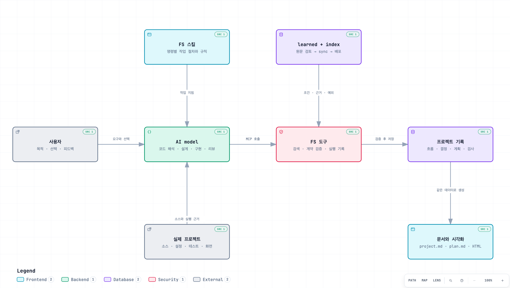
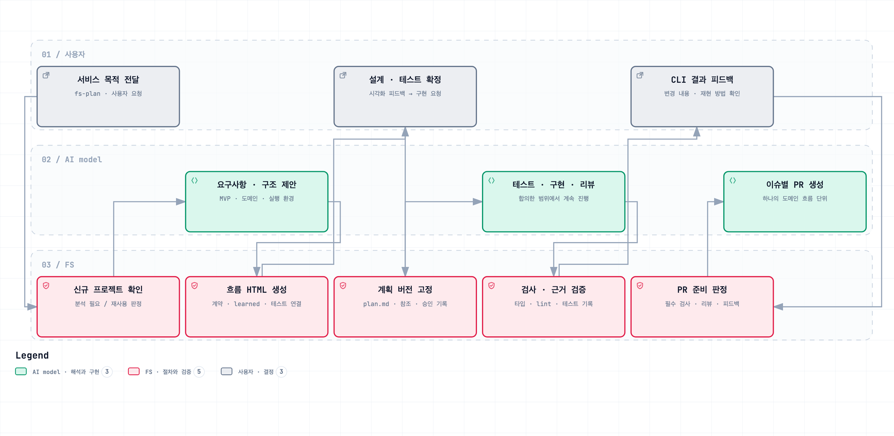
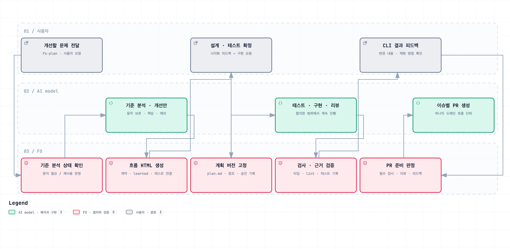
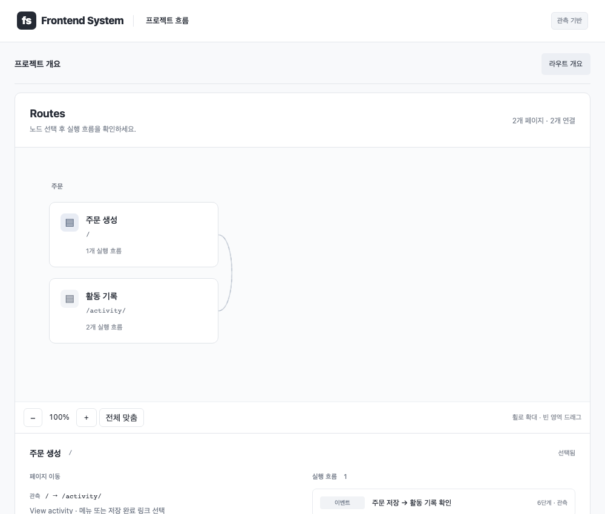
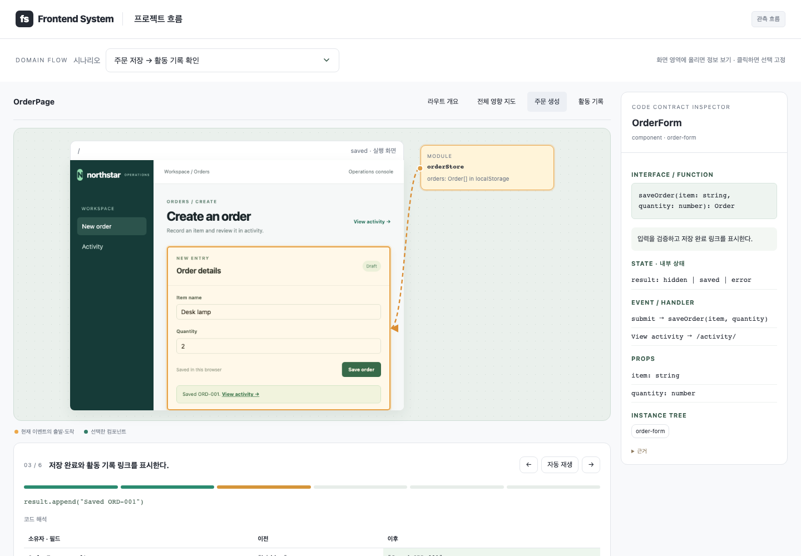
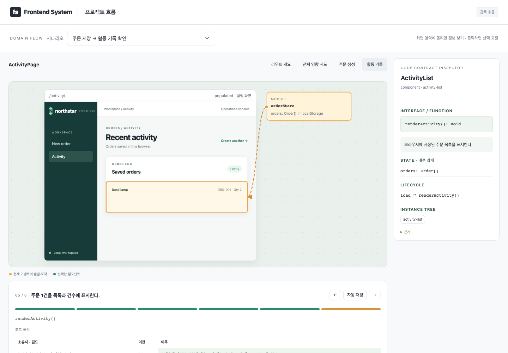

# Frontend System

**FS는 개발자의 의도와 축적한 지식을 AI의 설계·구현에 연결하는 Codex·Claude Code 플러그인입니다.** 프로젝트 코드에서 적용 근거를 찾고, 사용자와 합의한 흐름·계약·테스트를 계획으로 고정해 구현과 리뷰까지 이어갑니다.

## 어떻게 동작하나요?



[구조도 탐색하기 · Archify HTML](docs/diagrams/guide/architecture.html)

| 담당 | 책임 |
| --- | --- |
| **사용자** | 원하는 결과, 트레이드오프, 설계 승인과 구현 피드백 |
| **AI model** | 코드·호출 관계 해석, 지식 적용 판단, 질문, 설계·구현·리뷰 |
| **FS** | 작업 절차 제공, 지식 후보 검색, 근거·계약·버전 검증, 기록과 HTML 생성 |

**지식이 구현에 반영되는 경로**

```text
원문과 코드 예제 → 근거·조건·예외 검토 → sync → learned + 검색 색인
                                                   ↓
요청 + 코드의 구조적 신호 + AI의 관찰 → 관련 지식 후보 → 적용 조건 판단
                                                   ↓
사용자 결정 → 흐름·인터페이스·테스트 설계 → plan → 구현 → 검증·리뷰
```

- **trigger는 검토의 시작점입니다.** 검색 결과만으로 코드를 고치지 않고, AI가 호출부·상태 소유권·예외를 확인합니다.
- **FS는 별도 AI를 실행하지 않습니다.** 현재 대화의 모델이 해석하고 구현하며, 도구는 저장된 근거와 계약을 검사합니다.
- **같은 구조 데이터를 재사용합니다.** 사람은 문서·HTML을 보고, AI는 필요한 JSON·코드 참조를 읽습니다.

## 설치

**일반 터미널에서 실행합니다.** Node.js, Git과 사용할 클라이언트가 필요합니다. 프로젝트에 FS를 npm 의존성으로 설치할 필요는 없습니다.

### Codex

```bash
codex plugin marketplace add Yelihi/frontend-system --ref release
codex plugin add frontend-system@frontend-system
codex plugin list --marketplace frontend-system --json
```

업데이트:

```bash
codex plugin marketplace upgrade frontend-system
codex plugin add frontend-system@frontend-system
```

### Claude Code

```bash
claude plugin marketplace add Yelihi/frontend-system
claude plugin install frontend-system@frontend-system --scope user
```

업데이트:

```bash
claude plugin marketplace update frontend-system
claude plugin update frontend-system@frontend-system --scope user
```

설치·업데이트 후 **대상 프로젝트에서 새 세션**을 시작하세요. 설치 채널은 `release`이며, main의 변경이나 지식 sync만으로 설치본이 바뀌지는 않습니다. 아래 흐름은 **0.12.0 기준**입니다.

## 상황별 사용 흐름

**아래 예시는 AI 대화창에 입력합니다.** Codex에서는 `$fs-plan`, Claude Code에서는 `/frontend-system:fs-plan`처럼 스킬을 선택할 수 있습니다.

그림의 행과 테두리 색으로 책임을 구분합니다: **회색 = 사용자 / 초록 = AI model / 분홍 = FS**. 작은 글씨는 이미지를 클릭해 확대하거나 HTML에서 확인하세요.

### 1. 처음 프로젝트를 만들 때

```text
fs-plan 이력서 관리 서비스를 만들고 싶습니다.
우선 개인 사용 MVP로, 이력서를 저장하고 수정하는 기능부터 설계해주세요.
```



[새 프로젝트 흐름 탐색](docs/diagrams/guide/new-project.html)

- **사용자:** 목적·필수 기능·제약을 설명하고, 제안된 화면과 테스트를 확인합니다.
- **AI:** 도메인·아키텍처·프레임워크·검증 환경을 제안합니다. 이미지가 없으면 와이어프레임부터 만듭니다.
- **FS:** 아직 없는 코드를 현재 사실로 기록하지 않고, 제안된 흐름·지식 근거·구현 계약을 연결합니다.

### 2. 기존 프로젝트를 리팩터링할 때

```text
fs-plan 주문 저장 흐름을 리팩터링하고 싶습니다.
현재 동작은 유지하면서 인증 중복과 컴포넌트의 책임을 정리해주세요.
```



[리팩터링 흐름 탐색](docs/diagrams/guide/refactor.html)

- **FS:** 전체 분석이 없으면 먼저 `fs-project` 절차로 연결합니다. 부분 분석은 이어서, 오래된 근거는 갱신, 최신 기록은 재사용합니다.
- **AI:** 환경 → 아키텍처·의존성 → 라우트·이벤트·상태·오류 흐름을 분석하고, learned의 적용 조건과 개선 근거를 확인합니다.
- **사용자:** 유지할 동작과 변경 범위를 결정합니다. AI는 기존 동작을 보호할 테스트를 확인한 뒤 구현합니다.

### 3. 기존 프로젝트에 새 기능을 추가할 때

```text
fs-plan 주문 목록에 필터와 페이지네이션을 추가해주세요.
기존 요청 계층과 상태 관리 방식을 활용하고, 로딩·빈 결과·실패 화면도 설계해주세요.
```


[새 기능 흐름 탐색](docs/diagrams/guide/feature.html)

- **AI:** 공용 함수·상태·캐시와 다른 페이지에 미치는 영향을 확인합니다. 전체 리팩터링을 임의로 시작하지 않습니다.
- **FS:** 현재 프로젝트와 이슈 설계를 같은 시각화 진입점에 연결하되, 관찰된 코드와 제안을 구분합니다.
- **사용자:** 시각화에서 성공·실패 흐름과 함수·컴포넌트 계약을 다듬고, 계획을 확정합니다.

### 세 상황에 공통인 구현·피드백 절차

| 순서 | 진행 방식 |
| --- | --- |
| 설계 논의 | AI가 근거와 선택지를 제시합니다. 중요한 미결정 사항은 네이티브 질문 UI에서 답변을 기다립니다. |
| 계획 확정 | 흐름·계약·규칙·위험별 테스트를 검토합니다. **“이 계획대로 구현해주세요”**로 `fs-work` 절차를 시작할 수 있습니다. |
| 연속 구현 | AI가 필요한 테스트 작성·재사용 → 구현 → 검사 → 리뷰를 진행합니다. 새로운 도메인 결정이 필요할 때만 다시 질문합니다. |
| CLI 피드백 | 변경 내용, 주의점, 테스트 근거와 직접 재현 방법을 확인합니다. 전체 diff도 요청할 수 있습니다. |
| PR | 하나의 도메인 흐름을 한 이슈로 묶어 브랜치·PR을 만듭니다. 필수 검사나 피드백이 누락되면 FS의 PR 제출 절차를 중단합니다. |
| 병합 후 | 로컬 기준 브랜치에 병합 결과를 반영하고 `fs-project update`를 실행합니다. 다음 plan·visualize 진입에서도 변경을 확인합니다. |

**한 이슈 = 하나의 도메인 흐름:** 주문 저장의 검증·API·상태 갱신·실패 복구·테스트를 함께 다룹니다. UI·서버 요청·테스트를 각각 다른 이슈로 쪼개지 않습니다.

자동 병합·배포는 하지 않습니다. 로컬 작업만 원하면 `fs-work <계획 이름> 로컬 구현만, PR 생성하지 마세요`라고 지정하세요. 기준 분석은 로컬 통합 브랜치의 커밋을 사용하며 자동 fetch하지 않습니다.

## 실제 화면에서 흐름 확인하기

**FS 자체 페이지 렌더러**로 만든 주문 앱 예제입니다. 위의 플러그인 구조·사용 흐름 설명만 Archify로 만들었습니다.



- **라우트 개요:** 페이지 관계를 먼저 보고, 확인할 페이지와 흐름을 선택합니다.



- **단계별 실행:** 도메인 설명을 먼저 읽고 함수 호출·상태 전후 값·컴포넌트 연결을 확인합니다.



- **페이지 간 영향:** 한 이벤트가 다른 페이지·store·캐시에 미치는 영향을 따라갑니다.
- **설계 검토:** 기록된 코드 계약, learned 적용·제외 근거와 테스트 항목을 확인합니다.
- **현재 / 이슈 설계:** `.frontend-system/diagrams/index.html`에서 선택합니다. 병합 후 실제 코드를 재확인해 기준 자료를 갱신합니다.

[직접 탐색하는 HTML](docs/diagrams/routed-flow/index.html) · [예제 코드](docs/examples/routed-order-app/) · [캡처와 재생성 근거](docs/diagrams/routed-flow/README.md)

사진은 실행 가능한 예제 앱의 실제 캡처입니다. 모든 함수 호출 시점의 스크린샷이나 실시간 디버거는 아니며, 캡처하지 못한 프로젝트 화면은 구조 보기와 누락 상태로 표시합니다.

<details>
<summary>GitHub에서 HTML이 소스로 보인다면</summary>

저장소를 내려받은 뒤 루트에서 실행합니다.

```bash
python3 -m http.server 4173
```

- FS 화면 예제: <http://localhost:4173/docs/diagrams/routed-flow/>
- 플러그인 구조: <http://localhost:4173/docs/diagrams/guide/architecture.html>

Archify 그림 본문은 한국어이며, 고정 뷰어 UI와 HTML 언어 속성은 영어입니다.

</details>

## 핵심 함수와 스크립트

| 코드 | 하는 일 |
| --- | --- |
| [`projectAnalysisReadiness`](src/application/project-readiness.ts) | 기준 커밋·분석 상태·의존성 변경으로 전체 분석 / 이어서 분석 / 갱신 / 재사용을 구분 |
| [`inspectCode`](src/application/knowledge/code-triggers.ts) → [`routeKnowledge`](src/application/knowledge/routing.ts) | 코드 특징을 추출하고 요청·파일명·구조 신호로 learned 후보와 의미 검토 질문 검색. 적용 여부는 AI가 판단 |
| [`writeProjectArtifacts`](src/application/project-store.ts) | 검증된 분석에서 사용자 설명서·AI 참조·프로젝트 시각화 자료 저장 |
| [`saveProjectChange`](src/application/project-changes.ts) · [`composeProjectViews`](src/application/project-visualization.ts) | 기준 자료에 이슈의 추가·교체·제거를 연결하고, 공통 ID와 계약 충돌을 검사해 통합 뷰 구성 |
| [`saveRevision`](src/application/workflow-store.ts) | 계획·이슈·규칙·테스트와 근거 버전을 묶어 저장. 변경 시 기존 승인 재사용을 제한 |
| [`startWork`](src/application/start-work.ts) · [`completeWork`](src/application/complete-work.ts) | 승인 계획으로 실행을 시작하고, 검사·리뷰·사례 근거를 확인해 완료 기록. 복수 이슈는 개별 도구로 진행 |
| [`workReview`](src/application/work-review.ts) · [`checkPrReadiness`](src/application/pr-readiness.ts) | CLI 검토 자료를 만들고 최신 검사·리뷰·피드백을 바탕으로 PR 준비 여부 판정 |
| [`validateKnowledgeSync`](src/application/knowledge/catalog.ts) · [`markKnowledgeSynced`](src/application/knowledge/catalog.ts) | 원문 승인·해시·참조·시험 기록의 정합성을 검사하고 sync 반영 상태 기록 |
| [`build.mjs`](skills/fs-plan-visualize/scripts/build.mjs) · [`viewer.html`](skills/fs-plan-visualize/scripts/viewer.html) | 구조 데이터와 화면 자산을 탐색 가능한 HTML로 생성·표시 |
| [`release.mjs`](scripts/release.mjs) · [`publish-release.mjs`](scripts/publish-release.mjs) | 버전·배포 파일 정합성 검사, 검증된 릴리스 발행과 설치 채널 갱신 |

<details>
<summary>폴더와 생성 문서</summary>

| 위치 | 내용 |
| --- | --- |
| `skills/` | 사용자 명령과 AI의 실행 절차 |
| `knowledge/source/` | 원문·코드 예제·출처와 검토 상태 |
| `references/learned/` | sync된 판단 지식과 `index.json` 검색 색인 |
| `mandatory-rules/` · `references/workflows/` | 기본 규칙과 단계별 절차 |
| `src/mcp.ts` · `src/application/` | 도구 진입점과 분석·계획·검증 로직 |
| 대상 프로젝트의 `.frontend-system/project.md` | 현재 기준 코드의 사용자용 설명서 |
| `.frontend-system/evidence/` | AI가 재사용할 근거와 구조화된 분석 기록 |
| `.frontend-system/plans/<계획>/` | `plan.md`·`plan.ai.md`와 결정·실행·검증 기록 |
| `.frontend-system/diagrams/index.html` | 현재 프로젝트·이슈 설계를 여는 시각화 진입점 |

</details>

## 명령어 빠른 참조

| 대화창에서 입력 | 용도 |
| --- | --- |
| `fs-project` / `fs-project update` | 전체 프로젝트 분석 / 기준 분석 갱신 |
| `fs-plan <요청>` | 도메인·화면·계약·테스트를 논의해 계획 작성 |
| `fs-plan-visualize <흐름 또는 계획>` | 현재 코드 또는 지정한 설계를 시각화 |
| `fs-work <계획 이름>` | 승인 계획의 테스트·구현·검증·피드백·PR |
| `fs-review <대상>` | 근거 기반 리뷰. 제품 코드 수정은 별도 요청 |
| `fs-review pre-pr --base origin/main --plan <계획>` | PR 제출 준비 검사 |
| `fs-review pr <URL> learn` | 댓글의 의도·반례를 검토해 프로젝트 결정·지식 후보 기록 |
| `fs-knowledge add <메모 또는 URL>` | 원문을 정리해 공식 FS 저장소에 pending PR 생성 |

<details>
<summary>지식을 추가하고 sync하려면</summary>

```text
fs-knowledge add
출처: 문서 URL 또는 직접 작성한 설명
배운 점: 어떤 판단에 도움이 되는가
적용 상황과 예외: 언제 쓰고, 언제 쓰지 않는가
예제: 기존 코드와 변경 코드, 기대하는 동작
```

| 단계 | 담당과 의미 |
| --- | --- |
| pending | 사용자·AI가 원문과 예제를 정리해 PR 제출 |
| active | 관리자가 metadata로 검토 대상을 선택. `fs-knowledge active`로 수집·구조화 |
| review → merged | AI가 근거·조건·예외를 검토하고 도구가 현재 원문에 대한 유효한 승인 확인. `merged`는 계산된 검토 상태 |
| sync | 검토된 지식을 learned·색인으로 연결. 적용·제외·정보 부족 사례와 기존 참조의 회귀 확인 |
| release | 관리자가 배포하고 소비자가 설치본 업데이트 |

관리자는 **FS 원본 저장소**에서 `fs-knowledge update`로 대상 목록 확인 → 검토 → 참조 보강 → 시험 → sync를 순서대로 진행할 수 있습니다. `review`와 `sync`도 따로 실행할 수 있습니다.

GitHub PR 병합 자체가 active 선택·지식 승인·sync를 대신하지 않습니다. 프로젝트 결정은 로컬에 유지하며, 공유할 후보만 이 절차로 보냅니다. [원문 템플릿](knowledge/source/template.md)

</details>

## 지금까지의 주요 개선

- **판단 근거:** 원문·예제·적용 조건·예외와 코드 근거를 연결하고, 검색 후보와 실제 채택을 구분.
- **맥락 재사용:** 커밋·파일 해시와 참조를 보존해 변경 범위 재분석. 같은 소스의 불필요한 재조회 축소.
- **합의 후 연속 작업:** 중요한 선택은 네이티브 질문, 확정 후에는 테스트·구현·검증을 연속 수행. [0.9.0 변경](https://github.com/Yelihi/frontend-system/commit/38351cc)
- **지식 업데이트:** 기존 learned 보강 시 기존 근거와 사례도 재검사하고 실패·미검증을 분리. [0.10.0](https://github.com/Yelihi/frontend-system/releases/tag/v0.10.0)
- **화면과 설계 통합:** 공통 흐름 데이터에 화면 상태·계약·learned 판단·테스트를 연결. [0.11.0](https://github.com/Yelihi/frontend-system/releases/tag/v0.11.0)
- **프로젝트와 이슈 연결:** 분석이 없으면 전체 분석부터, 기준이 바뀌면 갱신. 현재 흐름과 제안을 한 진입점에서 탐색. [0.12.0](https://github.com/Yelihi/frontend-system/releases/tag/v0.12.0)

검증 기록은 **실행한 검사와 확인한 범위**를 보여줍니다. AI의 모든 해석이 옳거나, 일반 AI보다 품질·토큰 사용량이 항상 우수하다는 보장은 아닙니다. [평가 자료](test/evals/README.md)
