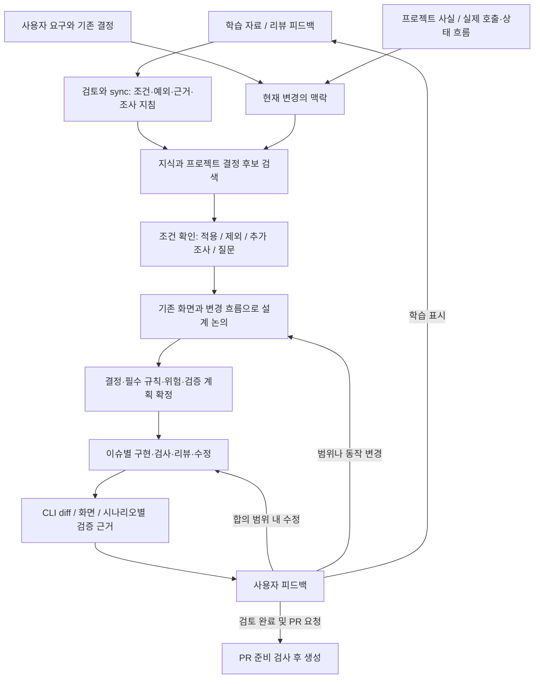

# FS 재설계안: 사용자 의도에서 검증된 구현까지

작성: 2026-10-19 · 검토 기준: `8a96e74b5360d0d2aa7c9ad3e35e2ff34c9d5b68` (0.8.1)

상태: 2026-10-19 기준 1차 리팩터링을 구현·검증하고 FS 0.9.0 릴리스 대상으로 준비했다.
이 문서는 설계 근거와 후속 평가 기준이며, 대상 프로젝트의 특정 revision 승인 기록은 아니다.

## 1. 목적과 성공 조건

**FS는 사용자의 맥락과 AI 구현의 맥락을 일치시킨다.**
학습한 지식을 조건부 판단으로 sync하고, 프로젝트에서 합의한 선택을 다음 작업에서도 찾아 적용하며,
그 선택을 위반한 구현이 완료로 보고되지 않도록 검증한다.

사용자는 도메인·시각적 흐름·위험과 테스트 의도를 검토한다. AI는 합의된 범위의 구현·테스트·수정을
연속 수행하고, 사용자가 CLI에서 변경과 검증 근거를 확인할 수 있도록 제공한다.

- 같은 적용 조건의 결정은 다음 세션에서도 재사용한다. 다른 조건에는 억지로 적용하지 않는다.
- 지식이 적어도 관련 오류 처리·신뢰 경계·비동기 상태·프레임워크·접근성 위험을 검토한다.
- 요구하지 않은 도메인, 추상화, 상태와 방어 로직을 추가하지 않는다. 필요성은 실제 흐름과 위험으로 설명한다.
- 테스트 개수와 문서 분량이 아니라 반복 지적, 누락 오류, 사용자 검토 부담, 전체 작업 비용으로 평가한다.
- 규칙의 의미 판단은 여전히 모델 판단이다. 해시·인용·스키마 검증을 의미적 정답이나 무결점 보증으로 표현하지 않는다.

## 2. 현재 코드에서 확인한 기반과 빈틈

이번 조사는 관련 경로의 정적 검토다. 실제 모델 동작이나 실패 빈도를 측정한 결과는 아니다.

| 코드 근거 | 현재 동작 | 재설계 판단 |
| --- | --- | --- |
| [routing.ts](../../src/application/knowledge/routing.ts), [trigger-review.ts](../../src/application/knowledge/trigger-review.ts) | 코드 신호·요청·파일명·일부 구조적 힌트로 공용 지식 후보를 검색 | 유지. 후보 검색과 적용 판단을 구분하고 프로젝트 결정 검색을 함께 제공 |
| [investigation.ts](../../src/application/knowledge/investigation.ts) | 적용·제외 조건, 인용, 의도 확인, 불명확한 판단을 검증 | 유지. 질문에 답이 기록됐다는 사실과 답의 타당성은 별도 검토 |
| [project-facts.ts](../../src/application/project-facts.ts) | 분석한 사실의 의존 파일·설정·신호를 확인하고 의미 트리거 재사용 | 유지. 사실 재사용과 사용자 결정 재사용을 같은 것으로 취급하지 않음 |
| [workflow-store.ts](../../src/application/workflow-store.ts)의 saveProjectRecord/workflowContext, [task-context.ts](../../src/application/task-context.ts) | 프로젝트 결정은 Markdown으로 저장하고 목록으로 노출. 현재 revision의 결정은 제공하지만 작업에 맞는 과거 결정 본문·조건 검색은 이 경로에서 자동 수행하지 않음 | 확인된 연결 빈틈. 호스트가 수동으로 찾아 읽는 지침을 구조화된 검색·적용 기록으로 보완 |
| [rule-resolver.ts](../../src/application/rules/rule-resolver.ts) | mandatory·사용자·프로젝트 규칙과 모델 보완 관점을 컨텍스트에 제공 | mandatory 표시만으로 실행 검사가 생기는 것은 아님. 필요한 보장을 policy 검사/리뷰와 연결 |
| [design-contract.ts](../../src/application/design-contract.ts), [policy.ts](../../src/application/policy.ts) | 결정→규칙→이슈 연결, 필수 검사·리뷰, 검사 자산 보호 검증 | 재사용. 새로운 범용 규칙 엔진을 만들 필요 없음 |
| [workflow-store.ts](../../src/application/workflow-store.ts)의 saveExecution | testCases가 있는 이슈는 사용자 확인과 테스트 파일 해시가 있는 testReview 없이는 완료 거부 | 최신 사용 요구와 충돌. 테스트 의도는 계획 때 승인하고 코드 검토는 구현 후 통합하도록 버전 전환 필요 |
| [staged-planning.md](../../references/workflows/staged-planning.md), [fs-work](../../skills/fs-work/SKILL.md) | 여러 설계 확인과 이슈별 테스트 코드 피드백 중단을 요구 | 단순 문구 삭제로 해결 불가. 실행 검증·스키마·테스트와 함께 변경 |
| [pr-readiness.ts](../../src/application/pr-readiness.ts), [pr-readiness.md](../../references/workflows/pr-readiness.md) | 현재 소스의 검사·안전/범위 리뷰·실제 PR diff 및 이슈 범위 검증. 기본 전달은 이슈별 PR | 검증은 유지. 기술적 준비 완료와 사용자 구현 검토 완료를 분리 |
| [flow-schema.ts](../../src/application/flow-schema.ts), [시각화 build.mjs](../../skills/fs-plan-visualize/scripts/build.mjs) | 흐름·시나리오·구체 계약과 화면 기반 뷰를 보유 | 재사용. 시나리오→계획 테스트 사례→실행 증거의 명시적 ID 연결 보완. 문자열 설명만으로 연결됐다고 간주하지 않음 |
| [frontend-quality.md](../../references/frontend-quality.md) | 프레임워크·상태 수명·실패·비동기·최소 설계·테스트 위험 지침 존재 | 기본 품질 지침을 처음부터 다시 쓰지 않음. 작업별 적용 결과를 검토 자료에 연결 |

주된 가설은 **기반 기술이 전혀 없어서가 아니라, 저장한 판단이 다음 구현까지 이어지는 연결과 사용자 검토 흐름이 약하다**는 것이다.
이 가설은 실제 프로젝트에서 검증해야 한다. 현재 모든 실패의 원인으로 확정하지 않는다.

## 3. 하나의 연결 구조



별도의 거대한 통합 문서를 만들지 않는다. 기존 기록이 담당할 사실을 유지하고 ID로 연결한다.

| 정보 | 기준이 되는 기록 | 다른 표현의 역할 |
| --- | --- | --- |
| 현재 코드에서 확인한 사실 | 기존 프로젝트 evidence / flow 기록과 의존 해시 | project.md는 설명과 탐색 입구 |
| 반복 사용할 사용자 결정 | 프로젝트 로컬의 구조화된 결정 기록 | 목록·짧은 요약을 먼저 전달하고 필요할 때 본문 읽기 |
| 이번에 구현할 계약 | revision.json의 decisions / policy / issues | plan.md와 plan.ai.md는 동일 계약의 표현 |
| 검사·리뷰 결과 | checks / reviews / execution의 현재 증거 | CLI 보고와 HTML은 그 증거를 조회하는 표현 |
| 화면 | 대상 앱에서 실행·캡처한 자료와 버전 | 화면과 흐름을 겹쳐 보여주되 캡처만으로 호출 추적을 증명하지 않음 |

사실·규칙·추론을 분리한다. 기존 코드에 어떤 패턴이 있다는 이유만으로 사용자가 승인한 규칙으로 만들지 않는다.

## 4. 사용자 결정의 저장과 재사용

공용 지식은 가능한 판단을 설명한다. 프로젝트 결정은 이 프로젝트에서 선택한 기준이다.
프로젝트 결정이 공용 지식의 release/sync를 기다리지 않고 다음 작업에서 재사용될 수 있어야 한다.

기존 `.frontend-system/decisions/`를 유지하며 신규 구조화 기록을 추가하는 방향을 제안한다.
기존 Markdown은 원문으로 보존하고 자동 승인·변환하지 않는다. 기존 decision/인용 타입을 재사용하고
다음 의미만 보완한다. 하나의 거대한 온톨로지나 벡터 DB는 첫 구현 범위에 넣지 않는다.

| 필요한 의미 | 내용 |
| --- | --- |
| 식별·출처 | ID, 버전, 사용자 확인, 원래 계획/리뷰 근거, active/superseded 상태 |
| 적용 범위 | 프로젝트 영역·작업 종류·관련 심볼/경로/의미 신호. 새 파일도 작업 의도로 후보가 되어야 함 |
| 적용·제외 조건 | 적용할 맥락, 정당한 예외, 다시 논의할 조건 |
| 실제 선택 | 해야 할 것, 하지 않을 것, 구현자가 선택할 수 있는 범위 |
| 재사용 진입점 | 기존 함수/컴포넌트/설정 위치, 관련 계약과 정상 사용 예시 |
| 검증 | 기존 policy 규칙·검사·리뷰 참조 |

예시(사용자가 준 인증 사례를 설명하기 위한 가상 이름이며 실제 프로젝트 조사 결과가 아님):

```text
결정: 개인 데이터의 서버 조회는 기존 requireUser()를 재사용한다.
조건: 사용자 세션에 근거한 개인 데이터 접근이다.
예외: 공개 조회 또는 별도로 인증되는 백그라운드 작업.
보존: 기존 미인증 실패 계약과 리소스 소유권 검사.
금지: 새로운 조회마다 세션 확인을 복사한다.
재검토: 인증 방식이나 실행 환경이 바뀐다.
검증: 호출 경로 확인 + 미인증 시 데이터 접근이 발생하지 않는 테스트.
```

새 작업에서는 다음 순서로 처리한다.

1. 작업 의도·대상 파일·사용 기술·실제 코드 신호로 공용 지식과 프로젝트 결정의 후보를 찾는다.
2. 적용 이유와 필요한 호출부·상태 소유자·기존 공용 진입점을 짧게 반환한다. 파일명 일치만으로 적용하지 않는다.
3. AI가 조건과 예외를 실제 코드 및 현재 요구와 비교한다. 코드로 확인할 수 있는 것은 먼저 조사한다.
4. 같은 조건의 기존 결정은 출처와 함께 채택한다. 이미 답한 질문은 반복하지 않는다.
5. 조건이 다른 후보는 제외하고 이유를 남긴다. 새 도메인 선택이나 충돌만 사용자에게 묻는다.
6. 채택한 결정의 버전·검사·의무를 현재 revision에 연결한다. 원본 결정이 바뀌면 조용히 덮어쓰지 않는다.

신규 경로 때문에 기존 부재 판단이나 적용 범위가 달라질 수 있다. 파일 해시가 그대로라고 의미까지 재검증됐다고 간주하지 않는다.
의존 코드 변경은 재검토 요청이고, 사용자의 결정 자체를 삭제할 이유는 아니다.
명시적인 새 지시와 과거 선택이 충돌하면 영향을 밝히고, 새 지시가 범위를 충분히 확정했을 때 같은 질문을 되묻지 않는다.
안전 검토에서 드러난 위험은 선호 규칙으로 숨기지 않고 별도 실패 조건으로 제시한다.

## 5. 지식 sync와 강한 구현 규칙의 연결

pending → 사용자 active 지정 → review → merged → sync의 기존 발행 흐름은 유지한다.
sync된 각 지식은 가능한 범위에서 다음을 제공해야 한다.

- 관찰 가능한 진입 신호와 그 신호만으로 결론낼 수 없는 부분.
- 조사할 호출부·소유권·입출력·실패 조건에 대한 구체적인 질문.
- 적용 조건, 예외, 지켜야 할 동작, 대안과 비용.
- 검증 가능한 주장에는 정상·위반·제외·정보 부족 예시.

이미 존재하는 investigation/triggerChecks/retrievalChecks를 우선 사용한다.
공용 지식이 자동으로 프로젝트의 필수 규칙이 되지는 않는다.
**후보 검색 → 적용 근거 확인 → 프로젝트 결정/이번 계획에 채택 → policy 연결 → 구현 검증**을 거쳐야 한다.

강제 수준도 구분한다.

| 판단 | 수행과 한계 |
| --- | --- |
| 기계 검사 가능 | 기존 타입·lint·경계 검사·행동 테스트를 우선 사용하고 실패 시 완료/PR 경로 차단 |
| 의미 검토 필요 | 결정과 실제 diff·호출부·실패 경로를 비교한 구체적 리뷰 필요. “검토했다”만으로 통과시키지 않음 |
| 사용자 선택 필요 | 선택이 달라지면 도메인 동작·공개 계약·소유권·범위가 바뀌는 경우에 질문 |

FS는 호스트의 임의 파일 수정과 외부 PR 생성 명령을 가로막는 실행 샌드박스가 아니다.
보장하는 범위는 FS 완료·전달 경로에서의 검증이다. 원격 병합 강제는 해당 저장소 CI 설정을 따로 확인해야 한다.

## 6. 작업 흐름과 멈추는 시점

새 워크플로의 기본 사용자 확인 지점은 세 곳이다. 각 지점에서는 필요한 만큼 논의할 수 있다.

1. **설계:** 기존 흐름과 연결된 제안 화면, 도메인·상태 소유권·컴포넌트 책임·주요 예외를 논의한다.
2. **계획:** 흐름별 구현 범위, 재사용할 코드, 금지 사항, 위험과 테스트 시나리오를 함께 확정한다.
3. **구현 검토:** 파일별 diff, 실제 화면, 실행 증거, 미확인 범위를 제공하고 피드백을 반영한다. 완료 후 PR을 진행한다.

계획 승인 후에는 테스트 작성 → 구현 → 검사 → 리뷰 → 계약 내 수정까지 진행한다.
테스트 의도와 기대 결과를 바꾸지 않는 보강에 별도 사용자 승인을 요구하지 않는다.
테스트 코드 전문을 읽게 하는 중간 정지 대신 구현 검토에서 핵심 assertion과 실행 결과를 연결해 제공한다.

실행 중 다음 경우에는 의존하는 작업을 멈춘다: 미해결 도메인 선택, 승인 범위 변경, 계약을 깨는 해결책만 남음,
검증에 필요한 환경/권한/정보 부재. 정상적인 컴파일 오류나 합의 범위 내 테스트 실패는 AI가 먼저 해결한다.
재시도는 유한해야 한다. 기존 attempt 제한을 우회해 기록을 초기화하지 않으며, 소진 시 원인과 진행 상황을 보고한다.

`complete`(기술 검증 통과)와 `사용자 검토 완료`는 별개로 기록한다. 후자는 현재 diff 범위/해시에 연결하고
피드백으로 코드가 바뀌면 필요한 검사·리뷰와 사용자 변경 확인을 갱신한다.
기존 이슈별 branch/PR 기본값은 유지하되, PR 생성 앞에 구현 피드백을 배치한다.
사용자가 명시적으로 일괄 검토를 요청하면 그 범위에 맞게 전달하고, 자동 병합/배포 권한으로 확대하지 않는다.

버그 수정 진입점은 우선 기존 fs-review/debugging → plan/work를 재사용한다.
별도 fs-error 명령 추가는 이 흐름을 새로 구현하는 대신 동일 경로의 단축 진입점이 필요한지 사용 후 판단한다.
project.md 및 observed 흐름은 사용자의 업데이트 요청이나 해당 작업에 포함된 명시적 갱신 범위에서 수정한다.
검증 전 proposed 상태를 실제 구현 사실로 바꾸지 않는다.

## 7. CLI와 시각화의 검토 계약

추가할 자료는 독립 보고서 더미가 아니라 기존 기록에서 만드는 조회 결과다.

```text
흐름: 개인 자료 조회
결정: 기존 인증 함수 재사용 / 새 캐시를 만들지 않음
변경: 어떤 파일의 어떤 책임이 바뀌었는가 + 실제 diff
위험: 미인증 요청이 저장소까지 도달함
시나리오: 세션 없음 → 요청 → 인증 오류, 저장소 호출 0회
검증: 테스트 위치/사례 ID → 실행 명령/환경/현재 소스 → 결과/로그
화면: 해당 시나리오에서 실제로 캡처한 상태
한계: 모의 저장소 테스트인지 실제 환경 실행인지 구분
```

flow/scenario ↔ issue/testCase ↔ check/review/result를 명시적 ID로 연결한다.
문자열에 테스트 이름을 언급한 것, package test 스크립트 전체 통과, 스크린샷 존재만으로 사례별 통과를 표시하지 않는다.
첫 지원은 실제 대상 프로젝트의 기존 테스트 러너 결과 형식 하나에 맞춘다. 지원하지 않는 러너는 command-level 결과로 남긴다.
러너 원시 결과의 사례 식별자, 대상 버전, 아티팩트 경로를 보존하고 추출할 수 없는 경우 사례 결과는 unknown/not-run이다.

CLI는 흐름별 변경 파일/이유를 먼저 보여주고 해당 diff를 제공한다. 전체 diff도 열 수 있게 한다.
HTML은 기존 화면과 흐름 표시를 유지하며 관련 위험·테스트·실행 결과로 이동할 수 있게 한다.
실제 캡처, 제안 시안, 정적 해석, 실제 실행 흔적을 구분한다. 캡처 실패를 빈 화면으로 성공 처리하거나 가짜 화면으로 대체하지 않는다.
작업과 관계없는 모든 페이지·모든 브라우저를 매번 재생성/테스트하지 않고, 승인한 영향 범위와 지원 환경을 검사한다.

## 8. 파일별 리팩터링 순서와 완료 기준

각 단계는 하나의 동작 연결을 끝까지 구현·검증한다. 파일 분리 자체를 목적으로 workflow-store 전체를 재작성하지 않는다.
실제 편집 시 이 표보다 범위가 넓어지면 이유를 먼저 설명한다.

| 단계 | 수정 대상 | 변경 내용 | 완료 기준 |
| --- | --- | --- | --- |
| 1. 중단 지점 정리 | skills/fs-plan/SKILL.md, skills/fs-work/SKILL.md, references/workflows/staged-planning.md, user-decisions.md, pr-readiness.md, src/application/workflow-store.ts, revision-input.ts, pr-readiness.ts, task-context.ts, src/mcp.ts | 새 workflow 버전의 계획 승인/연속 실행/구현 후 검토 의미를 일치시킴. 테스트 코드 중간 승인 대신 계획의 테스트 계약과 사후 증거를 검증 | 승인 범위 내 실행에 불필요한 질문 없음. 필수 검사 실패·테스트 기대값 무단 변경·미검토 diff로 전달 불가 |
| 2. 결정 재사용 | src/application/workflow-store.ts의 기존 기록 API, 필요 시 단일 project-decisions.ts, task-context.ts, design-evidence.ts, design-contract.ts, src/mcp.ts, fs-plan/fs-review 지침, references/workflows/pr-feedback.md | 프로젝트 로컬 결정 타입/검색/버전과 현재 계획 연결. 공용 knowledge routing과 검색 이유를 구분하여 함께 반환 | 새 파일/새 세션에서도 기존 공용 인증 선택 검색. 공개 조회 예외는 강제하지 않음. 변경·철회·충돌 처리 확인 |
| 3. 검증 근거 연결 | workflow-store.ts의 testCases/check/review, run-capabilities.ts, revision-response.ts, src/cli.ts, src/mcp.ts | 사례별 위험·검증 결과 연결과 CLI diff/증거 조회. 기존 러너 결과와 로그를 재사용 | command 통과만으로 모든 사례를 passed로 승격하지 않음. 누락/skip/실패/오래된 결과를 표시하고 필수 보장 미충족 시 차단 |
| 4. 시각화 연결 | flow-schema.ts, project-flows.ts, render-project-flow.ts 및 실제 호출 경로, skills/fs-plan-visualize/scripts/build.mjs·compose.mjs·board.js·viewer.html, 관련 skill | 기존 시나리오와 계획 사례/실행 증거 연결을 화면에 투영. 계획 추가 시 기존 observed 기준 보존 | 존재하지 않는 사례/버전 참조 거부. 실제 앱 화면과 단계 변화 확인. 정적 해석을 runtime 검증으로 표시하지 않음 |
| 5. 피드백 학습과 안내 | fs-review/fs-knowledge 지침, references/workflows/pr-feedback.md, 기존 contribution/source-state 경로 중 필요한 곳, README.md | 명시적 학습 요청을 로컬 결정/공유 후보로 구분. CLI 사용 예시와 변경 설명 | 리뷰 의견을 자동으로 공유 필수 규칙으로 승격하지 않음. 다음 작업에서 실제 재사용되는지 확인 |

호출부·스키마 출력·패키징도 함께 검사한다. public input 변경 시 `scripts/export-tool-schemas.mjs`와
빌드 생성물을 기존 빌드 절차로 갱신하고 package 검증을 수행한다. 배포 버전 변경은 실제 배포 단계에서 한다.

회귀 검증 위치: `test/plans-project.test.ts`, `test/workflow.test.ts`, `test/policy-workflow.test.ts`,
`test/design-evidence.test.ts`, `test/pr-readiness.test.ts`, `test/knowledge-triggers.test.ts`,
`test/knowledge-sync-routing.test.ts`, `test/project-flows.test.ts`, `test/observed-flow.test.ts`,
`test/flow-design.test.ts`, 기존 시각화 브라우저 검사. 변경 경로에 맞는 테스트만 우선 확장한다.

### 저장 형식 전환

- 새로운 워크플로 버전을 명시한다. 버전이 없는 기존 계획은 현재 중간 테스트 승인 의미를 유지한다.
- 진행 중 계획을 전환할 때 기존 결정·이슈·증거를 보존한 새 revision으로 전환하고, 기존 승인을 새 의미로 자동 재사용하지 않는다.
- 기존 결정 Markdown은 읽을 수 있도록 남긴다. 구조화할 때 원문과 사용자 확인을 연결하고, 불명확하면 후보로 둔다.
- 새 형식을 이해하지 못하는 구버전 도구가 기록을 조용히 덮어쓰지 않도록 버전 호환 검사를 포함한다.
- 검증 강도를 낮추기 위해 testReview를 무조건 optional 처리하거나 기존 실패 테스트를 삭제하는 방식은 사용하지 않는다.

### 1차 구현 기록

- `project-decisions.ts`가 조건·예외·진입점·확인 내용을 프로젝트 로컬 기록으로 저장하고 작업 맥락에서 후보를 찾는다. 기존 Markdown은 후보로 자동 채택하지 않는다.
- 계획 형식 3은 승인한 테스트 사례를 구현 후 현재 검사/리뷰 근거에 연결하고, 완료 후 현재 소스에 대한 사용자 피드백을 PR 준비 조건으로 둔다. 기존 형식 2의 테스트 코드 확인 절차는 유지한다.
- `fs work-review`는 현재 변경 파일·사례 근거·diff를 CLI에 표시한다. MCP 요약은 diff를 포함하지 않아 모델 입력을 줄인다.
- 흐름 HTML은 계획의 시나리오별 사례와 근거 상태를 표시한다. 페이지 탐색기는 계획 사례를 표시하되 통과 여부를 자체 판정하지 않는다.
- 실제 대상 프로젝트에서 반복 설명 감소, 판단의 적용/제외 정확도, 사용자 검토 시간은 아직 측정하지 않았다. 따라서 일반 AI 대비 우위는 이 구현만으로 주장하지 않는다.

## 9. 설계 자체의 재검토

| 반례/우려 | 설계 보완 |
| --- | --- |
| 모든 지식을 읽으면 토큰이 증가 | 작업 범위의 후보 요약 → 조건 확인에 필요한 본문만 조회. 변경 없는 결정·근거의 중복 전달 방지 |
| 이전 결정을 무조건 강제하면 오류도 반복 | 조건/예외/재검토 사유/철회 상태와 현재 근거 확인. 사용자가 정한 프로젝트 선호와 기술적 사실 분리 |
| 계획이 너무 상세하면 구현의 장점을 잃음 | 도메인 결과·상태 소유권·외부 계약·재사용 진입점은 고정. 내부 지역 변수·루프·작은 함수 구성은 재량 |
| 승인을 줄이면 테스트가 약해짐 | 사람은 기대 동작과 실패 시나리오를 승인. 자동 검사는 실제 실행, 리뷰는 assertion·mock·누락을 확인 |
| 동일 AI가 작성하고 통과시킴 | 기계 검사와 의미 리뷰를 구분. 중요 위험은 재현/실패 주입으로 검출 확인. 별도 리뷰 기능은 가능한 환경에서 활용하되 독립성 보장으로 과장하지 않음 |
| 화면이 있으면 실제 흐름까지 검증된 것처럼 보임 | 캡처와 호출 추적의 근거를 분리. 실제 실행 결과 없는 edge는 정적 해석/제안으로 표시 |
| 기록을 더 늘려 사용이 복잡해짐 | 기존 저장소와 ID 연결을 우선 사용. CLI/HTML은 동일 자료의 표현으로 만들고 사용자가 JSON을 편집할 필요를 줄임 |
| 질문 없이 일하다 다른 요구를 구현 | 승인된 범위 밖의 도메인 선택은 멈춤. 필수 검사 실패는 내부 수정, 해결에 범위 변경이 필요하면 질문 |

재검토 결론: **기존 지식/근거/검증 기반을 보존하고, 프로젝트 결정 검색·작업 중단 정책·사례별 증거 연결을 우선 바꾼다.**
새 에이전트 실행 프레임워크, 범용 온톨로지, 전체 코드의 완전 의미 그래프는 이 단계의 선행조건이 아니다.

## 10. 실제 프로젝트에서 확인할 실험

먼저 실제 대상 프로젝트 한 곳의 연속 작업으로 확인한다. 아래 사례는 후보이며 해당 프로젝트 코드를 먼저 확인한다.

1. 개인 데이터 조회: 기존 인증·에러 처리의 재사용을 합의한다.
2. 새 세션에서 다른 개인 데이터 조회 추가: 같은 선택을 다시 설명하지 않아도 재사용하는지 확인한다.
3. 공개 조회 또는 다른 인증 경로: 겉모습이 비슷해도 기존 선택을 잘못 강제하지 않는지 확인한다.
4. 상태가 있는 UI 작업: 취소·지연 응답·실패 중 실제 위험이 있는 시나리오 하나를 정하고 설계→테스트→실제 화면까지 연결한다.

FS 내부 연결을 먼저 검증한 뒤 모델 비교를 한다. 동일 모델/코드 시작점/요구/도구 권한/지원 환경/작업 제한을 사용하고,
각 실행은 독립 checkout과 새 대화에서 시작한다. 연속 작업에서는 저장된 기억만 유지하고 대화 기억은 초기화한다.
사용자에게 필요한 질문은 사람이 답하거나 사전에 정한 동일 의미의 답변을 제공한다. 한쪽에만 원하는 결론을 알려주지 않는다.

비교군은 일반 AI, 동일 지식·결정을 원문으로 제공한 AI, FS를 구분한다.
일반 AI와의 차이만으로 sync 효과라고 주장하지 않는다. 같은 정보를 받은 조건이 구조화/검색의 추가 가치를 확인한다.
FS가 만든 상세 plan을 양쪽에 동일 제공하는 구현 비교는 별도 유지할 수 있지만, 결정 검색 능력 평가로 해석하지 않는다.

| 지표 | 계산/관찰 |
| --- | --- |
| 결정 적용 정확도 | 사전에 판정한 적용/제외/질문 사례별 기대 판단과 실제 판단, 누락·오적용을 따로 집계 |
| 반복 설명 | 동일 조건·동일 결정에 대해 사용자가 다시 설명해야 한 횟수 |
| 구현 일치 | 합의한 필수 보장 중 충족/미충족/미확인. 분모를 고정하고 구현 후 유리하게 바꾸지 않음 |
| 검증 유효성 | 실제 실패 재현 또는 한정된 잘못된 변형을 의도한 이유로 검출했는지. 환경 오류는 검출로 세지 않음 |
| 사용자 부담 | 설계 확인·구현 diff 검토·수정 피드백에 쓴 실제 시간과 중단 횟수 |
| 비용 | 분석/검색/설계/구현/검증/재작업별 입력·캐시·출력 토큰과 전체 시간. 수집 불가능한 항목은 추정치로 섞지 않음 |

작은 파일럿은 연결이 작동하는지 확인하는 용도다. 우위를 선언하려면 반복 실행의 개별 값과 분포,
사례 차이와 측정 한계를 함께 보고한다. 첫 적용 사례의 실패, 예외 오적용, 기록 없는 통과 주장을 먼저 해결한다.
같은 이유로 개선이 멈추면 평가 기준을 바꾸어 승리시키지 않고 병목 또는 접근 한계를 보고한다.

## 11. 이후 변경 보고 형식

모든 리팩터링 결과에서 다음을 보고한다.

| 파일 | 바꾼 동작 | 변경 이유 | 검증 |
| --- | --- | --- | --- |
| 실제 변경 경로 | 이전 → 이후 | 사용자 요구 또는 확인된 결함 | 실행한 검사와 결과/미실행 |

사용자가 확인할 핵심 diff, 저장 형식/기존 사용자에 미치는 영향, 남은 한계를 함께 제공한다.
설계 제안·구현 완료·테스트 통과·배포 완료를 서로 구분한다.
